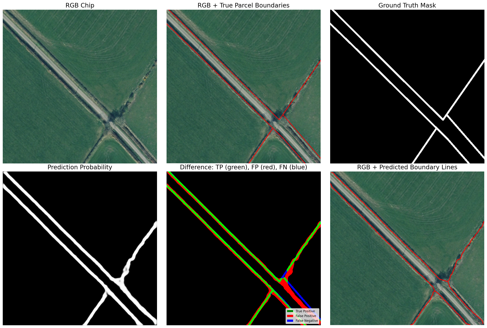

# Boundary Segment
Predict land parcel boundaries using high resolution aerial photography and segmentation models such as [U-Net](https://arxiv.org/abs/1505.04597) and [Unet++](https://arxiv.org/abs/1807.10165).


# Setup
This process uses open source geospatial packages and PyTorch. Use of a GPU is recommended for training the models and making predictions. 

**Note:** Full details on setup and the code is outlined below. A Word document with internal guidance, `Boundary_prediction_process.docx`, gives a quicker start. It is internal, so it may not be in your copy of the repository.

## Using Docker
You can optionally use the Docker setup used during development of this process. This is found under `/.devcontainer`. 

1. First cd to the repo and build the Docker image:
```bash
docker build -t boundary-segment -f .devcontainer/Dockerfile .
```

2. Run the container (mounting current directory to /app):
```bash
docker run --gpus all -it --rm -v $(pwd):/app boundary-segment

# Windows Powershell use this instead:
docker run --gpus all -it --rm -v "${PWD}":/app boundary-segment
```

If you use VS Code and Docker a devcontainer.json is included under `/.devcontainer`. In this case you do not need to run the docker commands above, just open the repository in VS Code and under Command Palette use Devcontainer: Reopen in container.

## Without Docker
The `requirements.txt` can be used to install the packages needed, if not on Windows. It pins the versions the pipeline was last run with (Python 3.11). `gdal` is not pinned, as it must match the GDAL library on your system.

**For Windows users** as the process uses GDAL, you will probably find it easier to install the geospatial packages with Conda. 

### Instructions for Windows users (non-Docker)
1. With Conda available on your machine, create a conda environment and install the geospatial packages with a conda install command.

```bash
# create conda geo_env and install gdal etc
conda create -n geo_env python=3.11 pip gdal rasterio geopandas shapely -c conda-forge
# activate the new env
conda activate geo_env
```

2. With the `geo_env` environment active, pip install the remaining packages into the conda python home.
```bash
# install torch
python -m pip install torch==2.9.1 torchvision==0.24.1 --index-url https://download.pytorch.org/whl/cu126

# install other packages, e.g. rschip not on conda-forge
# (see requirements.txt for the versions last used)
python -m pip install rschip segmentation-models-pytorch albumentations opencv-python-headless pytest black ruff flake8 tqdm scikit-learn scikit-image matplotlib pandas scipy ipykernel pyyaml
```

# Training a segmentation model
After you `git clone` this repository, you should acquire some images and put them into the repository `inputs/` directory.  

This process has been developed using the aerial photography available from [Bluesky under the APGB](https://apgb.blueskymapshop.com). 

Scripts are available in this repository to complete all processing steps required, starting from the JPEG files you can request to download from Bluesky under the APGB.  

The code in this repository is a series of Python scripts with input arguments specified in the terminal. For all the scripts described below, you can get help by running the following in the terminal:
```bash
python path/name_of_script.py --help
```

## Expected input directory structure

```
inputs/
├── images/
│   └── <area_name>/               ← APGB JPEG files and world files (.jgw) go here
├── master_dataset_parcels/        ← national land parcels dataset (for Step 0)
├── <area_name>_parcels.gpkg       ← land parcel polygons
└── <area_name>_prediction_mask.gpkg  ← optional prediction mask
```

The parcels and prediction mask can be made from the national parcels dataset with Step 0, or supplied by hand.

After running Steps 1–3 the `inputs/images/` tree will be populated with GeoTIFFs, a VRT, and chip files automatically.

## Process overview

Existing land parcel polygons are available for each area where the model will be applied, but some may be out of date and no longer match what is visible in the latest aerial photography. Only parcels that still accurately reflect the imagery are suitable as training data. This process is designed to identify those suitable parcels, fine-tune the model for each location, and create predictions suitable for change detection. The steps are shown in the diagram below.




The aerial photography is first pre-processed into fixed-size image chips for input to the base model. Initial predictions are then made and compared against the existing land parcels to identify which chips have boundaries that still match the imagery. These are the chips suitable for training. After filtering to the most suitable chips, the model is fine-tuned for that location. The final predictions from the locally fine tuned model can be used for change detection. The ultimate aim is prioritising parcels for review and update by the mapping team.


The scripts generally should be run in the following order, as each step produces outputs that the next step depends on.


| Step | Script | Key input | Key output |
|------|--------|-----------|------------|
| 0 | `utils/preprocess_parcels.py` | JPEG images + national parcels | Parcels and prediction mask `.gpkg` clipped to the imagery |
| 1 | `utils/assign_crs_to_images.py` | JPEG images + prediction mask (optional) | GeoTIFFs with CRS |
| 2 | `utils/create_vrt.py` | GeoTIFFs | `.vrt` mosaic |
| 3 | `utils/chip_image.py` | `.vrt` + prediction mask (optional) | Chip `.tif` files + `chips_index.gpkg` |
| 4 | `unet/create_masks.py` | Chip TIFFs + parcels | Binary mask TIFFs |
| 5 | `unet/split_dataset_train_test.py` | Chips + masks | `dataset/` train/val/test split |
| 6 | `unet/train.py` | `dataset/` | Trained model `.pth` |
| 7 | `unet/predict.py` | Chip TIFFs + model + prediction mask (optional) | Boundary lines `.gpkg` |
| 8 | `unet/line_evaluate.py` | Predictions `.gpkg` + parcels + prediction mask (optional) | TP/FP/FN lines `.gpkg` |
| 9 | `unet/chip_metrics.py` | TP/FP/FN lines + chips index | `chips_index_metrics.gpkg` |
| 10 | `unet/filter_training_chips.py` | `chips_index_metrics.gpkg` | Updated `chips_ignore.csv` |

After completing Step 10, re-run Step 5 with the updated `chips_ignore.csv` to produce a cleaner dataset before retraining the model and creating new predictions.

`run_pipeline.py` runs the steps in this order: 0 to 5, 7 with the base model, 8 to 10, 5 again, 6, then 7 with the fine-tuned model and a final evaluation. The first pass skips Step 6, because the base model is already trained. The first Step 5 is a preliminary split: it finds the background-only chips and records which split each chip is in, both of which Step 9 needs. The split is rebuilt after Step 10 has updated `chips_ignore.csv`.


## 0. Prepare parcels and prediction mask
The parcels and prediction mask for an area are cut from the national land parcels dataset. The extent of the aerial photography is the union of the JPEG footprints, read from their world files (`.jgw`) in EPSG:27700. Parcels intersecting the extent are selected and clipped to it.

The prediction mask is made from the same parcels before clipping, so the size test uses each parcel's full area. Parcels smaller than `--mask-threshold-ha` (default 50 ha) are dissolved, buffered by `--mask-buffer` (default 50 m) and clipped to the extent. This leaves out large upland parcels, which do not have boundaries suitable for prediction. The buffer keeps predictions made slightly beyond the mapped parcels, where the parcel mapping does not match the imagery exactly.
```bash
python utils/preprocess_parcels.py --img-dir inputs/images/invergordon --national-parcels inputs/master_dataset_parcels/shp_20260126.shp --output-parcels inputs/invergordon_parcels.gpkg --output-mask inputs/invergordon_prediction_mask.gpkg --output-extent inputs/invergordon_aerial_extent.gpkg
```

Give `--output-parcels`, `--output-mask` or both. Existing files are not replaced unless `--overwrite` is given.

## 1. Assign CRS and convert jpegs to geotiffs
The APGB images do not have a CRS and arrive in jpeg format.
```bash
python utils/assign_crs_to_images.py --img-dir inputs/images/gretna
```

When the optional `--prediction-mask` argument is provided, only GeoTIFFs whose bounding box intersects the mask are written. The mask is reprojected to the target CRS (`--crs`, default EPSG:27700) on load.
```bash
python utils/assign_crs_to_images.py --img-dir inputs/images/gretna --prediction-mask inputs/gretna_prediction_mask.gpkg
```

## 2. Create a GDAL vrt from the images
A GDAL vrt is an XML reference file. It is much quicker to build and takes less disk space than building a mosaic image.
```bash
python utils/create_vrt.py --img-dir inputs/images/gretna/tiff_with_crs
```

## 3. Create chip images from vrt
Uses the [rs-chip](https://github.com/tomwilsonsco/rs-chip) package.  
The progress bar may take a while to update from 0%, as it only advances once a full batch is complete. If unsure whether the script is running, check that .tif files are appearing in the output directory.

```bash
python utils/chip_image.py --vrt inputs/images/gretna/tiff_with_crs/apgb_imgs.vrt --chip-size 512 --chip-offset 384 --resampling-factor 0.5
```

The `--resampling-factor 0.5` is used in this example to downscale the chips at the point of creation from 0.125 m per pixel in the source imagery to 0.25 m, requiring 4 times fewer chips to cover a given extent. The output chip size (512 in this example) accounts for the downscaling and output chips will be 0.25 m per pixel and 512 by 512 pixels. 

When the optional `--prediction-mask` argument is provided, chips that do not intersect the mask are deleted from disk and recorded in `chips_ignore.csv` with condition `outside prediction mask`. The mask is reprojected to the VRT's CRS on load.
```bash
python utils/chip_image.py --vrt inputs/images/gretna/tiff_with_crs/apgb_imgs.vrt --chip-size 512 --chip-offset 384 --resampling-factor 0.5 --prediction-mask inputs/gretna_prediction_mask.gpkg
```

Chips that are not entirely within the imagery are recorded in `chips_ignore.csv` in the chips directory, with condition `outside image bounds`. The imagery is the area covered by the VRT's source tiles, not the VRT's bounding rectangle, so chips are also caught where the tiles form an irregular block. They stay on disk, so they are still predicted, but they are left out of the training dataset. A chip that is outside both the VRT extent and the mask is recorded once, as `outside prediction mask`. The csv is added to again in [10. Filter training chips](#10-filter-training-chips).

## 4. Create masks from land parcel lines
This will create an equivalent binary mask tif (1 for lines 0 for background) for each input image.
```bash
python unet/create_masks.py --chip-dir inputs/images/gretna/tiff_with_crs/chips --parcels inputs/gretna_parcels.gpkg
```
## 5. Create dataset for train, validation, test
Chips listed in `chips_ignore.csv` are left out of the dataset. Background-only chips (where the mask contains no boundary pixels) are also left out, unless `--no-filter-background-only` is given. They are not added to `chips_ignore.csv`: the check is recorded in `masks/background_only_check.csv`, which Step 9 also reads.

> **`chips_ignore.csv` - what is recorded**
>
> | Added by | Condition recorded |
> |---|---|
> | Step 3 (`chip_image.py`) | `outside image bounds`: chip falls partly outside the imagery |
> | Step 3 (`chip_image.py`) | `outside prediction mask`: chip does not intersect the mask (deleted from disk) |
> | Step 10 (`filter_training_chips.py`) | Corner clipper, invisible boundary, or extra boundary |
>
> `split_dataset_train_test.py` reads this file and excludes all listed chips.
> `filter_training_chips.py` keeps the Step 3 entries and replaces any earlier
> Step 10 entries when it writes new ones.

```bash
python unet/split_dataset_train_test.py --chip-dir inputs/images/gretna/tiff_with_crs/chips --mask-dir inputs/images/gretna/tiff_with_crs/chips/masks --output-dir inputs/images/gretna
```

## 6. Train model
Many of these args are the default values but included here for info.
```bash
# to see help on script arguments
python unet/train.py --help

# running the training
python unet/train.py --dataset-dir inputs/images/gretna/dataset --arch unetplusplus --encoder efficientnet-b3 --loss-method bce_dice --epochs 30 --batch-size 8 --lr 0.0001 --desc test-025m
```

## 7. Predict with model
Once a trained model is achieving test set prediction performance you are happy with, you can predict for all chipped images across a continuous extent and produce a geopackage output of the boundary line predictions.

This process takes a while to complete on large extents.

```bash
python unet/predict.py --chip-dir inputs/images/gretna/tiff_with_crs/chips
```

When the optional `--prediction-mask` argument is provided, the output prediction lines are clipped to the mask before saving. The mask is reprojected to the prediction lines' CRS on load.
```bash
python unet/predict.py --chip-dir inputs/images/gretna/tiff_with_crs/chips --prediction-mask inputs/gretna_prediction_mask.gpkg
```

As with the evaluate script, predict will use the latest trained model in `models/` unless the `--model` argument is used to specify a different one.

Chips overlap, so most mosaic pixels are predicted by more than one chip. Each pixel is taken from the chip where it sits furthest from the chip edge, so the cropped tiles fit together without overlapping. `--overlap-mode none` keeps every chip's full prediction in `temp_preds` instead, for per-chip diagnostics (`example_plots.py` uses it); don't use it for production lines.

## 8. Run line evaluation
The model's aim is to predict visible boundary lines. In this evaluation a predicted line segment is counted as a True Positive (TP) if it falls within a specified buffer distance of the mapped ground truth line.

This script accounts for this by specifying a buffer distance (metres) and then calculates lengths of true positive (TP), false positive (FP), false negative (FN) prediction line segments. These are written into a new output line geometry layer.

```bash
python unet/line_evaluate.py --pred-gpkg outputs/predictions/20260320_092233_20260319_215151_rgb025_unetplusplus_boundaries_50epoch.gpkg --parcels inputs/gretna_parcels.gpkg --chip-dir inputs/images/gretna/tiff_with_crs/chips --buffer-dist 3
```

When the optional `--prediction-mask` argument is provided, the ground truth parcel lines are clipped to the mask before evaluation. This ensures FN computation also respects the prediction mask boundary, preventing artificially high FN counts outside the area of interest. The parcel boundaries are clipped as lines, so where the mask edge cuts through a parcel, the cut is not counted as a boundary. The mask is reprojected to the prediction lines' CRS on load.
```bash
python unet/line_evaluate.py --pred-gpkg outputs/predictions/20260320_092233_20260319_215151_rgb025_unetplusplus_boundaries_50epoch.gpkg --parcels inputs/gretna_parcels.gpkg --chip-dir inputs/images/gretna/tiff_with_crs/chips --buffer-dist 3 --prediction-mask inputs/gretna_prediction_mask.gpkg
```

To compare two runs over the same chips (for example before and after a code change), evaluate both with `line_evaluate.py` and then run `compare_runs.py`. It reports precision, recall and F1 for each, how fragmented the lines are, whether line ends cluster at chip or chunk seams, and a spatial block bootstrap showing whether the difference is consistent across the area or down to chance.
```bash
python unet/compare_runs.py --baseline outputs/predictions/<old>_boundaries.gpkg --candidate outputs/predictions/<new>_boundaries.gpkg --chip-dir inputs/images/gretna/tiff_with_crs/chips --output-json outputs/predictions/compare.json
```

For `run_pipeline.py` runs, the evaluations are named by buffer, so pass them with `--baseline-eval` and `--candidate-eval`. Use the report-buffer evaluations, `<run_id>_base_result_compare.gpkg` or `<run_id>_<fine_tuned_desc>_result_compare.gpkg`, not the `_base_filter_` one. For example, base against fine-tuned within one run:
```bash
R=outputs/predictions/<run_id>
python unet/compare_runs.py --baseline $R/<run_id>_base_boundaries.gpkg --baseline-eval $R/<run_id>_base_result_compare.gpkg --candidate $R/<run_id>_fine_tuned_boundaries.gpkg --candidate-eval $R/<run_id>_fine_tuned_result_compare.gpkg --chip-dir $R
```
`--chip-dir` can be the run folder itself: it keeps `chips_index.gpkg` and `pipeline_config.yaml`, which is all `compare_runs.py` needs to find the chip grid, so runs can be compared after cleanup has deleted the chips.

## 9. Stats per chip
It is useful to see statistics per chip on lengths of prediction TP, FP, FN and these can be used to calculate precision and recall and then F1 scores per chip. 

This can be used to rank chips and review ones with a low F1 to discern chips with non-visible boundary lines (not benefitting training), from difficult to predict lines but that could be predicted by refining model training.

The `unet/chip_metrics.py` process adds these stats per chip to a copy of the index layer.

```bash
python unet/chip_metrics.py --line-comparison outputs/predictions/20260320_092233_20260319_215151_rgb025_unetplusplus_boundaries_50epoch_result_compare.gpkg --mask-dir inputs/images/gretna/tiff_with_crs/chips/masks --chips-index inputs/images/gretna/tiff_with_crs/chips/chips_index.gpkg --dataset-dir inputs/images/gretna/dataset --output-gpkg inputs/images/gretna/tiff_with_crs/chips/chips_index_metrics.gpkg
```

## 10. Filter training chips
To produce a good quality training dataset it can be useful to remove non-useful chips by making an initial prediction using a base model or early stopped model. The types of chips to remove:
1. "Corner clippers": Chips where a training data boundary line just clips the corner of the chip, otherwise no boundary lines seen in the chip.
2. "Invisible boundary": Chips with low recall. This could be because the boundary is not visible on the image.
3. "Extra boundary": Chips with low precision. This could be because the training data lines are out of date and new boundaries are seen on the image.

`chips_ignore.csv` records all chips to exclude: those outside the image extent or the prediction mask (added in Step 3), and the low-quality chips identified here. Background-only chips are left out separately by Step 5. Re-running Step 5 after this step will build a cleaner dataset that excludes all of these chips.

```bash
python unet/filter_training_chips.py --input-gpkg inputs/images/gretna/tiff_with_crs/chips/chips_index_metrics.gpkg --chip-dir inputs/images/gretna/tiff_with_crs/chips --min-training-length 30 --recall-min 0.5 --min-precision 0.5
```

After running Steps 8–10, re-run **Step 5** to create a new, cleaner dataset that
excludes the chips added to `chips_ignore.csv`. Then re-run **Step 6** to train a
new model on the improved dataset. Testing showed this iterative refinement produced
useful improvements in prediction quality.


## Additional Scripts

The following scripts are part of the repository but are not part of the main pipeline above.

| Script | What it does |
|---|---|
| `unet/evaluate.py` | Runs the trained model on each test set image and reports summary statistics: Intersection over Union (IoU) and Dice score. |
| `unet/example_plots.py` | Creates 6-panel PNG plots showing predictions on test set chips, including parcels overlay. Vary `--num-samples` and `--seed` to get different selections. |
| `utils/merge_training_datasets.py` | Merges two existing train/val/test dataset directories into one, prefixing filenames to avoid collisions. Useful when combining data from multiple geographic areas. |
| `unet/calculate_mask_proportion.py` | Samples a percentage of mask chips and reports the mean proportion of boundary pixels. Use the result to determine a sensible `--pos-weight` for `train.py`. |
| `unet/delete_dataset_chips.py` | Deletes chips listed in `chips_ignore.csv` from an existing dataset directory. An alternative to re-running `split_dataset_train_test.py` after filtering. |

# Running full pipeline
A Python wrapper script, `run_pipeline.py`, runs the entire pipeline described above: Steps 0–10 including the iterative predict - local training filter - retrain. Configuration is read from a YAML file so you can adjust parameters without editing the script.

In a terminal after `cd` to the repository run:

```bash
python run_pipeline.py --config pipeline_config.yaml
```

The `pipeline_config.yaml` file contains all configurable settings:

| Section | Key parameters |
|---------|----------------|
| `data` | Area name, paths to raw images, parcels GPKG, optional prediction mask, and the national parcels dataset used to create them if missing |
| `models` | Path to the pre-trained base model and description tag for fine-tuning |
| `parameters` | CRS, prediction mask area threshold and buffer, chip size/offset/resampling, filter and report buffer distances, filter thresholds, training hyperparameters including early-stop patience |
| `pipeline_settings` | Whether to preserve intermediate files after completion |

Edit `pipeline_config.yaml` for your area before running, or keep a separate configuration for each area: copy `pipeline_config.yaml`, edit the copy, and pass it with `--config`. Without `--config`, `pipeline_config.yaml` is used.

```bash
python run_pipeline.py --config pipeline_config_invergordon.yaml
```

A copy of the configuration used is saved in each run folder.

The parcels and prediction mask named under `data` are handled as follows, before anything else runs:

| Files under `data` | `national_parcels_dataset` | What happens |
|---|---|---|
| Both exist (or no mask is set) | Not needed | They are used as they are and Step 0 is skipped |
| One or both missing | Set and found | Step 0 creates the missing ones, plus `inputs/<area>_aerial_extent.gpkg` |
| One or both missing | Empty or not found | The run stops with an error naming the missing file |
| A file exists but has no features | Any | The run stops with an error |

To rebuild an area's parcels or mask, delete the file and run the pipeline again. Leave `prediction_mask_gpkg` empty to run without a mask.

Each run writes to its own folder, `outputs/predictions/<run_id>/`, where `run_id` is `<timestamp>_<area>`. The fine-tuned model goes to `models/<run_id>_<fine_tuned_desc>_<arch>.pth`. The run folder is kept even when intermediate files are cleaned up, and holds:

| File | Contents |
|------|----------|
| `<run_id>_base_boundaries.gpkg` | Lines predicted by the base model |
| `<run_id>_<fine_tuned_desc>_boundaries.gpkg` | Final lines, predicted by the fine-tuned model |
| `*_result_compare.gpkg`, `metrics_*.json` | TP/FP/FN lines and metrics: base model at the filter buffer (`base_filter`, used for chip filtering) and at the report buffer (`base`), fine-tuned model at the report buffer |
| `summary.json` | Run record: input files with checksums, models, chip counts by removal reason and split, and the three sets of metrics |
| `pipeline_config.yaml`, `chips_ignore.csv`, `chips_index_metrics.gpkg` | The settings and the chip filter result, enough to rebuild this area's training set later |
| `chips_index.gpkg` | Chip footprints, so `compare_runs.py` can be run on the folder after cleanup |
| `*_loss.png` | Training and validation loss |

The base model has never seen the area, so its report-buffer metrics are an out-of-sample score. The fine-tuned model is scored on the labels it was trained on, so its metrics are in-sample and somewhat optimistic. In a test, a model fine-tuned without seeing parts of the area scored about 0.02 F1 lower on those parts.

`predict.py` overwrites existing chip predictions in `<output-dir>/temp_preds`. Pass `--reuse-existing` (with `--keep-preds` on the first run) to re-vectorise kept predictions, for example at a different `--threshold`, without running inference again.

# Example prediction

